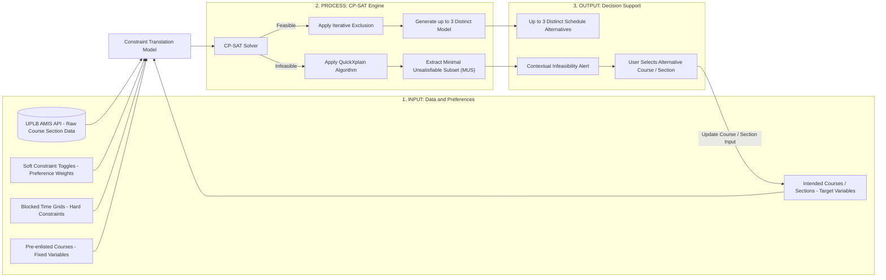
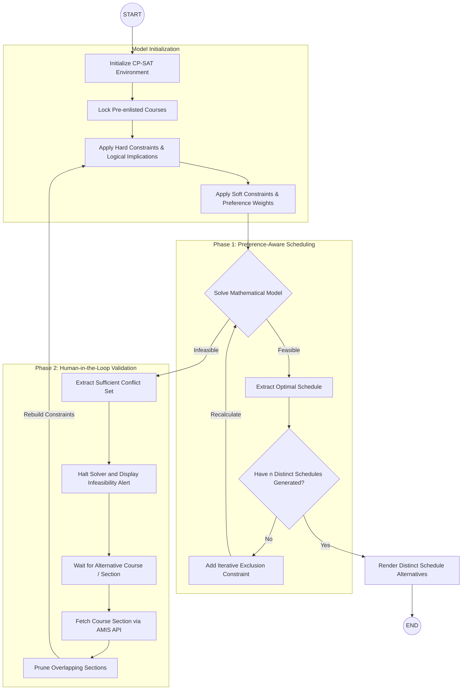
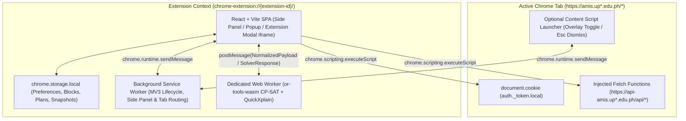

# AMISync — Engineering Specification

**Project Title:** AMISYNC: Preference-Aware Course-Section Selection with Infeasibility Explanation for UPLB AMIS Using In-Browser Constraint Programming  
**Target Environment:** Desktop Google Chrome (Manifest V3) integrating with authenticated sessions of the University of the Philippines Los Baños (UPLB) Academic Management Information System (AMIS)  
**Primary Sources:** `Paper Files/icsthesissample.tex`, `Paper Files/IPO.png`, `Paper Files/Decision-Tree.png`, `Paper Files/1.1.png`, `Paper Files/1.2.png`, `Paper Files/2.0.png`, and unpacked reference extension `AMISSU/` (`v1.3.0`).

---

## 1. System Overview & Scope

### 1.1 Purpose & Target Portal Integration
AMISync is a client-side Chrome Extension decision-support system for UPLB students preparing class schedules during registration on the **UPLB Academic Management Information System (AMIS)** (`https://amis.uplb.edu.ph/`, matching the UP AMIS host pattern `https://amis.up*.edu.ph`).

Whereas the existing UPLB reference extension **AMISSU** (`v1.3.0`) generates up to 100 unranked conflict-free schedule permutations via JavaScript recursive backtracking with pairwise time-overlap checks, AMISync upgrades micro-level course-section scheduling to exact, preference-aware combinatorial optimization with explainable conflict diagnosis:

| Capability | AMISSU Reference Extension (`v1.3.0`) | AMISync Target System |
| :--- | :--- | :--- |
| **Scheduling Engine** | JavaScript recursive backtracking (`Ac = 100` cap) | Exact CP-SAT solver via WebAssembly (`or-tools-wasm`, Google OR-Tools v9.x) inside a Web Worker |
| **Pre-enlisted Courses** | Displayed/included as enlisted courses (can be disabled per plan) | Hard-locked as fixed decision constants (`x = 1`), exempt from capacity pruning |
| **User Time Blocks** | Not supported | Visual hourly timetable grid (Mon–Sat, 7:00 AM–7:00 PM) enforced as hard constraints (`x = 0`) |
| **Preference Optimization** | Not supported (unranked permutations) | Weighted-penalty multi-objective function (`Off=0`, `Low=2`, `Medium=5`, `High=10`) covering fatigue, day bounds, Friday classes, active days, excessive gaps, and starred sections |
| **Section Controls** | Toggle selected/unselected, drag-reorder, hide closed classes | Per-section **Hide** (exclude, `x = 0`), **Lock** (`x = 1`), and **Star** (prioritize, `I_unstarred = 0`) |
| **Alternative Generation** | Up to 100 unweighted combinations | Up to **3 structurally distinct** feasible schedules via iterative exclusion cuts (minimum section difference `m` / Hamming distance `D >= 2` or `D >= 4`) and soft-preference profile alternation |
| **Infeasibility Feedback** | Generic text (`"Some of your selected classes are conflicting with each other"`) | QuickXplain **Minimal Unsatisfiable Subset (MUS)** extraction + deterministic natural-language relaxation templates triggering Human-in-the-Loop (HITL) Phase 2 adjustment |

### 1.2 Client-Side Architecture Overview
- **Zero Server-Side Solver Load:** All constraint modeling, CP-SAT solving, iterative exclusion, and QuickXplain MUS extraction run locally inside the student's browser via WebAssembly (`or-tools-wasm`) in a dedicated **Web Worker** to prevent UI main-thread blocking and avoid adding computational load to UPLB's centralized AMIS servers during peak enlistment windows.
- **UI Stack:** Single Page Application (SPA) built with **React** and **Vite**, compiled strictly to comply with Chrome Extension Manifest V3 Content Security Policy (CSP).
- **Local Persistence:** User preferences, time blocks, plans, and state are stored locally in `chrome.storage.local` without transmitting personal or academic preference data to external databases.
- **Reproducible Evaluation Mode:** Supports loading anonymized, static timestamped JSON snapshots of AMIS API payloads for offline benchmarking (Small: 3 courses / ~15–20 variables; Medium: 5 courses / ~40–60 variables; Large: 8 courses / ~100–150 variables) targeting:
  - **Schedule Validity Rate (SVR):** `100%` (zero temporal overlaps, intact parent-child linkages, valid capacity).
  - **Solver Execution Time:** Median `< 5.0 seconds` (well below the 10-second HCI/Google RAIL ceiling; per-run heuristic timeout `10.0 seconds` with 1 search worker).
  - **Conflict Diagnosis Accuracy:** Exact Match Ratio (EMR) on unique-MUS test cases, plus independent verification of irreducibility and unsatisfiability on real datasets.

### 1.3 Explicit Non-Goals (Delimitations)
AMISync strictly excludes the following:
1. **No Automatic Enlistment / Enrollment:** Strictly a read-only decision-support tool; does **not** automatically enlist, enroll, or mutate records in AMIS (unlike AMISSU's `POST /api/students/enlistments` bookmarking action, which is out of scope for AMISync's core optimizer).
2. **No Automated Degree Auditing or Prerequisite Validation:** Does not validate curriculum prerequisites, degree plans, or suggest automated curriculum substitutions. Course substitutions in Phase 2 (HITL) must be manually initiated and entered by the student.
3. **Desktop Google Chrome Only:** No mobile browser or cross-browser support.
4. **Regular Semesters Only:** Excludes Midyear terms.
5. **No TBA or Asynchronous Classes:** Excludes sections with `"To Be Announced"` (TBA) schedules or asynchronous online delivery modes lacking fixed day/time matrices.
6. **No Backend Capacity Control:** Operates solely on point-in-time client-side snapshots from the authenticated student's AMIS session; cannot override institutional capacities or master timetables, and live availability may shift between optimization and manual enlistment.
7. **No LLM / Heavy NLP Explanation Engine:** Conflict explanations are generated strictly through deterministic mapping from MUS variables into predefined natural-language templates.

---

## 2. Input-Process-Output (IPO) Pipeline

Directly mapped from `Paper Files/IPO.png` and `Paper Files/icsthesissample.tex` (Sections 2.3 and 3.1):



### 2.1 Stage-by-Stage Pipeline Breakdown

| Stage | Component | Exact Inputs / Operations / Outputs |
| :--- | :--- | :--- |
| **1. INPUT** | `UPLB AMIS API (Raw Course Section Data)` | Authenticated REST fetches of active term metadata, searched courses, course section lists (schedule matrices, rooms, capacities, parent-child links), and current student enlistments. |
| **1. INPUT** | `Soft Constraint Toggles (Preference Weights)` | User-configured dropdown weights (`Off=0`, `Low=2`, `Medium=5`, `High=10`) and slider thresholds (`T_fatigue`, `T_pref_start`, `T_pref_end`), plus starred section indicators. Stored in `chrome.storage.local`. |
| **1. INPUT** | `Blocked Time Grids (Hard Constraints)` | Hourly Mon–Sat (7:00 AM–7:00 PM) cells toggled as `BLOCKED` by the student on the visual schedule grid. |
| **1. INPUT** | `Pre-enlisted Courses (Fixed Variables)` | Student's currently enlisted / sent-to-SAIS sections fetched from AMIS (and/or locked sections), treated as immutable constants (`x = 1`) exempt from capacity pruning. |
| **1. INPUT** | `Intended Courses / Sections (Target Variables)` | Desired courses searched and added by the student, along with per-section hide (`x = 0`), lock (`x = 1`), and star states. |
| **Bridge** | `Constraint Translation Model` | Preprocessing & normalization step: (1) converts `"hh:mm AM/PM"` strings into minutes since midnight (`0..1440`) across day matrices; (2) filters out TBA/asynchronous sections without meeting days; (3) prunes zero-slot sections (`active_class_size >= max_class_size`) while exempting pre-enlisted sections; (4) detects exhausted-capacity courses early; (5) builds Boolean decision variables `x_{c,k,s}`, hard constraints, and normalized integer-scaled soft-penalty objective `Z`; (6) serializes payload to the WebAssembly Web Worker. |
| **2. PROCESS** | `CP-SAT Solver` | Executes Google OR-Tools CP-SAT (`or-tools-wasm`) inside a Web Worker (1 search worker, `10.0s` heuristic time limit). Returns `OPTIMAL`, `FEASIBLE`, or `INFEASIBLE`. |
| **2. PROCESS (Feasible)** | `Apply Iterative Exclusion` -> `Generate up to 3 Distinct Model` | Accumulates exclusion cuts excluding pre-enlisted sections so each subsequent schedule differs by at least `m` sections (minimum Hamming distance `D >= 2`, or `D >= 4` for stricter diversity), optionally alternating soft-preference profiles. Halts after 3 valid alternatives or when further cuts render the model infeasible. |
| **2. PROCESS (Infeasible)** | `Apply QuickXplain Algorithm` -> `Extract Minimal Unsatisfiable Subset (MUS)` | Validates Background Set consistency first; if consistent, sorts relaxable Foreground Set by descending user priority and runs divide-and-conquer QuickXplain in Pure Satisfiability Mode (`Z = 0`) to isolate an irreducible MUS (with memory/timeout fallback to a generic alert). |
| **3. OUTPUT (Feasible)** | `Up to 3 Distinct Schedule Alternatives` | Web Worker returns JSON payload of up to 3 optimized section-ID sets (with solver status `OPTIMAL`/`FEASIBLE` and objective score `Z`) rendered in the React timetable UI under the `PLAN:` selector dropdown (`Plan A`, `Plan B`, `Plan C`). |
| **3. OUTPUT (Infeasible & HITL Loop)** | `Contextual Infeasibility Alert` -> `User Selects Alternative Course / Section` -> `Update Course / Section Input` | Deterministic template engine maps MUS constraint variables to human-readable conflict bullets and relaxation advice inside the `SCHEDULE CONFLICTS` panel. User unblocks time slots, drops/modifies constraints, or searches for an alternative course/section, feeding back into `Intended Courses / Sections` to trigger targeted recalculation. |

---

## 3. Portal Section-Fetching & DOM/API Extraction Mechanism

All extraction mechanics below are reverse-engineered directly from `AMISSU/manifest.json` and `AMISSU/assets/index-728b0d85.js`.

### 3.1 Permissions, URL Patterns, and Execution Context in `AMISSU`
- **`AMISSU/manifest.json` Declarations:**
  - `manifest_version`: `3`
  - `permissions`: `["activeTab", "scripting", "storage", "sidePanel"]`
  - `host_permissions`: **None declared** in `AMISSU/manifest.json`.
  - `content_scripts`: **None declared** in `AMISSU/manifest.json`.
  - `background`: **None declared** in `AMISSU/manifest.json`.
- **Active-Tab Script Injection Bridge (`qe`):**
  AMISSU never uses declarative content scripts or cross-origin `host_permissions`. Instead, every AMIS read executes an isolated function inside the currently active tab via `chrome.scripting.executeScript`:
  1. Queries active tab: `chrome.tabs.query({ active: true, currentWindow: true })` and selects `tabs[0]`.
  2. Validates the active tab URL against the exact RegExp:
     ```js
     /.*\/\/amis\.up.*\.edu\.ph.*/.test(tab.url)
     ```
     If no tab exists or the regex returns `false`, the bridge immediately returns `null`.
  3. Executes the function in the AMIS page context:
     ```js
     const [{ result }] = await chrome.scripting.executeScript({
       target: { tabId: tab.id },
       func,
       args,
     });
     return result;
     ```
  4. **Origin-Matched API Base Derivation:** Inside every injected API function, the script extracts the portal hostname from `window.location.href`:
     ```js
     const match = window.location.href.match(/https?:\/\/(amis\.up.*\.edu\.ph)/);
     if (!match) {
       throw new Error("Script must be run on an AMIS website (amis.up*.edu.ph)");
     }
     const apiBase = `https://api-${match[1]}`; // e.g., "https://api-amis.uplb.edu.ph"
     ```
     Running `fetch()` from inside the AMIS tab ensures requests carry the exact `Origin: https://amis.uplb.edu.ph` header expected by `https://api-amis.uplb.edu.ph` CORS policies.

### 3.2 Authentication & Session Token Handling
- **Cookie Extraction (No DOM Scraping):** AMISSU does **not** scrape any HTML DOM elements (zero `querySelector` or `getElementById` calls against the AMIS page DOM). Its only access to the page `document` is reading the Nuxt Auth cookie `auth._token.local` from `document.cookie`:
  ```ts
  function extractAuthToken(): string | null {
    const raw = document.cookie
      .split("; ")
      .find((entry) => entry.startsWith("auth._token.local="))
      ?.split("=")[1];
    return raw === "false" || raw === undefined ? null : decodeURI(raw);
  }
  ```
- **Header Format:** `decodeURI(raw)` yields the full HTTP `Authorization` header value stored by AMIS (e.g., `Bearer <jwt>`). It is passed **verbatim** as `headers: { Authorization: token }` without prepending an extra `"Bearer "` prefix.
- **Token State Refresh Lifecycle:**
  - Loaded automatically on extension UI mount (`loadToken()`).
  - Subscribed to `chrome.tabs.onActivated.addListener(loadToken)` (cleaned up via `removeListener` on unmount) so switching to or away from an authenticated AMIS tab updates authentication state immediately.
  - When `token === null`, operations throw `"You are not authenticated. Open AMISSU over a logged-in AMIS website."` (adapted for AMISync UI messaging).

### 3.3 Exact Internal AMIS REST API Endpoints

All endpoints below are relative to `apiBase = https://api-${host}` (for UPLB: `https://api-amis.uplb.edu.ph`).

#### 1. Fetch Active / Next Enlistment Term (`GET`)
- **URL:** `${apiBase}/api/scheduled-features/student_enlistment?role=student`
- **Headers:** `{ Authorization: token }`
- **Response Fields Consumed:**
  ```json
  {
    "nextSchedule": { "term_id": 123 },
    "activeTerm": { "term_id": 122 }
  }
  ```
- **Term Resolution Logic:** `const termId = data.nextSchedule?.term_id ?? data.activeTerm.term_id;`

#### 2. Search Courses by Course Code (`GET`)
- **URL:** `${apiBase}/api/courses?course_code_like=${query}`
  - Note: AMISSU transforms the search input with `query.replace(" ", "+")` (for multi-space safety in AMISync, normalize internal whitespace and URL-encode spaces as `+`, e.g., `"CMSC 128"` -> `"CMSC+128"`).
- **Headers:** `{ Authorization: token }`
- **Response Wrapper:** `{ courses: RawAmisCourse[] }`
- **Exact-Match Disambiguation Logic (from AMISSU `ib`):**
  1. Filter returned `courses` where `course.course_code.toUpperCase() === input.toUpperCase()`.
  2. Because AMIS may return multiple historical/duplicate `course_id` records sharing the same `course_code`, execute Endpoint 3 in parallel (`Promise.all`) for every matching `course_id` and select the first `course_id` whose returned `classes` array is non-empty.
  3. Error conditions: `"Course not found"` (0 matches) or `"Course has no classes"` (all matches return 0 classes).

#### 3. Fetch Sections / Classes for a Selected Course (`GET`)
- **URL:** `${apiBase}/api/students/classes?status=Active&by_term_type=true&term_id=${termId}&course_id=${courseId}`
- **Headers:** `{ Authorization: token }`
- **Response Wrapper:** `{ classes: RawAmisClass[] }`
- **Usage:** Called both when adding a desired course (including Phase 2 HITL alternative course searches) and during periodic/manual course-plan refresh.

#### 4. Fetch Authenticated Student User Profile (`GET`)
- **URL:** `${apiBase}/api/auth/user`
- **Headers:** `{ Authorization: token }`
- **Response Wrapper:** `{ user: { id: number | string } }`
- **Usage:** Resolves `user.id` required as `enlistment_user_id` in Endpoint 5.

#### 5. Fetch Student's Current Enlistments / Pre-enlisted Classes (`GET`)
- **URL:** `${apiBase}/api/students/enlistments?enlistment_user_id=${user.id}&by_term_type=true&term_id=${termId}&enlistedClasses=true`
- **Headers:** `{ Authorization: token }`
- **Response Wrapper:** `{ enlistments: Array<{ student_enlistment_classes: RawStudentEnlistmentClass[] }> }`
- **Extraction & Status Classification Logic (from AMISSU `sb`):**
  - Reads `enlistments[0]?.student_enlistment_classes ?? []`.
  - Classifies each record `item` by `item.status`:
    - `item.status === "Enlisted"` or `item.status === "Sent to SAIS"` -> **Pre-enlisted / Locked Courses** (`enlistedCourses` — hard-locked as `x = 1` in AMISync).
    - `item.status === "Bookmarked"` -> **Bookmarked Courses** (optional reference list; not hard-locked).
  - Each item provides `item.class` (`RawAmisClass`) and nested `item.class.course` (`RawAmisCourse`).

#### 6. Reference-Only Endpoint in AMISSU (Explicitly Out of Scope for AMISync)
- `POST ${apiBase}/api/students/enlistments` with headers `{ Authorization: token, "Content-Type": "application/json" }` and JSON body `{ classes: [{ class_id: number, linked: number | false }], action: "Bookmarked", term_id: number }`, followed by `window.location.reload()` upon `response.status === "Ok"`.
- **AMISync Policy:** Excluded per Section 1.3 (Non-Goals); AMISync performs strictly **read-only** API calls against AMIS.

### 3.4 Raw Response Parsing into Normalized Course & Section Objects
Reverse-engineered directly from AMISSU's `ev` (course parser) and `ea` (recursive class/section parser) plus AMISync's preprocessing rules (`Paper Files/icsthesissample.tex`, Section 3.4):

1. **Course Parsing (`ev`):**
   - `id`: `String(raw.course_id)`
   - `code`: `raw.course_code` (e.g., `"CMSC 128"`)
   - `units`: `parseFloat(raw.units)` (e.g., `3`)
   - `canEnrollMultiple`: `Boolean(raw.is_multiple_enrollment)`
   - `instanceId`: `crypto.randomUUID()` (supports distinct instances when `canEnrollMultiple === true`)
2. **Recursive Section / Parent-Child Parsing (`ea`):**
   - `id`: `String(raw.id)`
   - `courseId`: `String(raw.course_id)`
   - `section`: `raw.section` (e.g., `"AB-1L"`, `"S"`, `"S-4L"`)
   - `activity`: `raw.activity === "" ? null : raw.activity` (e.g., `"LEC"`, `"LAB"`, `"RECIT"`, or `null`)
   - `faculties`: if `raw.hide_faculty === true` then `[]`, else map `raw.faculties` -> `{ firstName: f.faculty.user.first_name, middleName: f.faculty.user.middle_name, lastName: f.faculty.user.last_name }`
   - `location`: `raw.facility_id` (e.g., `"ICS LH3"`, `"ICS PC1"`, `"SMA LH"`)
   - `dates`: iterate `raw.class_dates`:
     - Build `days` array in canonical order from boolean flags: `mon -> "Monday"`, `tue -> "Tuesday"`, `wed -> "Wednesday"`, `thu -> "Thursday"`, `fri -> "Friday"`, `sat -> "Saturday"`.
     - If `days.length === 0` (TBA / asynchronous), omit this date entry.
     - Otherwise emit `{ days, startTime: rawDate.start_time, endTime: rawDate.end_time }`.
   - `activeClassSize`: `raw.active_class_size`
   - `maxClassSize`: `raw.max_class_size`
   - `isPrerogOpen`: `raw.is_prerog_open`
   - `parentClass`: recursively parsed via `parseRawClass(raw.parent)` (`null` if standalone/parent section). Note: The thesis references `parent_class_id` as the relational co-requisite link; in AMIS payloads, `raw.parent?.id` (and `raw.parent_class_id` if present in snapshots) identifies the parent lecture section.
3. **Time String to Minutes-Since-Midnight Conversion (AMISync Preprocessing):**
   - Input format verified from AMISSU regex `N1`: `/^(\d{1,2}):(\d{2})\s*([APap][Mm])$/` (e.g., `"08:00 AM"`, `"01:00 PM"`, `"12:00 PM"`).
   - Conversion rule (avoiding the `12:xx AM` edge-case bug in AMISSU's `Ni`):
     ```ts
     // 12-hour "hh:mm AM/PM" -> integer minutes in [0, 1440]
     let hours = Number(hStr);
     const minutes = Number(mStr);
     const meridiem = meridiemStr.toUpperCase();
     if (meridiem === "PM" && hours !== 12) hours += 12;
     if (meridiem === "AM" && hours === 12) hours = 0;
     const minutesSinceMidnight = hours * 60 + minutes;
     ```
4. **AMISync Capacity, TBA, and Sorting Rules:**
   - **TBA / Asynchronous Exclusion:** Drop any section (or parent-child pair where a required component) has zero fixed `dates` entries after parsing `class_dates`.
   - **Capacity Pruning:** Evaluate `activeClassSize` against `maxClassSize`; drop any non-pre-enlisted section with zero available slots (`activeClassSize >= maxClassSize`) *before* creating CP-SAT decision variables. **Pre-enlisted sections are strictly exempted** from capacity pruning.
   - **Canonical Section Sorting (from AMISSU `Xd`):** Sort sections by `(a.activity ?? "").localeCompare(b.activity ?? "") || a.section.localeCompare(b.section, undefined, { numeric: true })`.
   - **Refresh Timing Reference (from AMISSU `bC` / `$C`):** AMISSU auto-refreshes plans every **4 hours** (`differenceInHours >= 4`, polled every 5 seconds) and enforces a **30-minute** manual refresh cooldown persisted under `lastRefreshTime`.

---

## 4. Data Models & TypeScript Interfaces

All interfaces below align directly with the extracted AMIS API JSON schemas (`AMISSU/assets/index-728b0d85.js`), the thesis mathematical model (`Paper Files/icsthesissample.tex`), and the UI state (`Paper Files/1.1.png`, `1.2.png`, `2.0.png`).

### 4.1 Raw AMIS API Payload Contracts

```ts
export interface RawAmisTermScheduleResponse {
  nextSchedule?: { term_id: number } | null;
  activeTerm: { term_id: number };
}

export interface RawAmisAuthUserResponse {
  user: {
    id: number | string;
  };
}

export interface RawAmisCourse {
  course_id: number | string;
  course_code: string;
  units: string | number;
  is_multiple_enrollment: boolean;
}

export interface RawAmisCoursesResponse {
  courses: RawAmisCourse[];
}

export interface RawAmisClassDate {
  mon: boolean;
  tue: boolean;
  wed: boolean;
  thu: boolean;
  fri: boolean;
  sat: boolean;
  start_time: string; // "hh:mm AM/PM", e.g., "08:00 AM"
  end_time: string;   // "hh:mm AM/PM", e.g., "09:00 AM"
}

export interface RawAmisFacultyWrapper {
  faculty: {
    user: {
      first_name: string;
      middle_name: string;
      last_name: string;
    };
  };
}

export interface RawAmisClass {
  id: number | string;
  course_id: number | string;
  section: string;
  activity: string; // e.g., "LEC", "LAB", "RECIT", or ""
  hide_faculty: boolean;
  faculties: RawAmisFacultyWrapper[];
  facility_id: string | null;
  class_dates: RawAmisClassDate[];
  active_class_size: number;
  max_class_size: number;
  is_prerog_open: boolean;
  parent_class_id?: number | string | null; // Optional flat FK in snapshots
  parent: RawAmisClass | null;              // Nested parent LEC object in live AMIS API
  course?: RawAmisCourse;                   // Present inside enlistment responses
}

export interface RawAmisClassesResponse {
  classes: RawAmisClass[];
}

export type AmisEnlistmentStatus = "Bookmarked" | "Enlisted" | "Sent to SAIS" | string;

export interface RawStudentEnlistmentClass {
  status: AmisEnlistmentStatus;
  class: RawAmisClass & { course: RawAmisCourse };
}

export interface RawAmisEnlistmentsResponse {
  enlistments: Array<{
    student_enlistment_classes: RawStudentEnlistmentClass[];
  }>;
}
```

### 4.2 Normalized Domain Models (Courses, Sections, Timeslots)

```ts
export type Weekday =
  | "Monday"
  | "Tuesday"
  | "Wednesday"
  | "Thursday"
  | "Friday"
  | "Saturday";

export type ComponentType = "LEC" | "LAB" | "RECIT" | string;

export interface FacultyName {
  firstName: string;
  middleName: string;
  lastName: string;
}

/**
 * Normalized meeting interval in both display format and CP-SAT integer minutes.
 * Minutes range strictly over [0, 1440] (minutes since midnight).
 */
export interface TimeslotInterval {
  days: Weekday[];
  startTime: string;      // Original "hh:mm AM/PM"
  endTime: string;        // Original "hh:mm AM/PM"
  startMinutes: number;   // Integer in [0, 1440]
  endMinutes: number;     // Integer in [0, 1440]
}

/**
 * Normalized single AMIS class component (e.g., a standalone LEC or a LAB with parentClass).
 */
export interface NormalizedSection {
  id: string;                        // Stringified AMIS class id
  courseId: string;                  // Stringified AMIS course_id
  section: string;                   // e.g., "AB-1L", "S", "S-4L"
  activity: ComponentType | null;    // Normalized: "" -> null
  faculties: FacultyName[];
  location: string | null;           // From facility_id, e.g., "ICS LH3"
  dates: TimeslotInterval[];
  activeClassSize: number;
  maxClassSize: number;
  isPrerogOpen: boolean;
  parentClassId: string | null;      // Derived from parent.id ?? parent_class_id
  parentClass: NormalizedSection | null;
}

/**
 * Per-section user overrides captured from the Courses tab (Eye / Lock / Star icons).
 */
export interface SectionUserFlags {
  isHidden: boolean;       // Eye icon  -> Hard constraint: x_{c,k,s} = 0
  isLocked: boolean;       // Lock icon -> Hard constraint: x_{c,k,s} = 1
  isStarred: boolean;      // Star icon -> Soft constraint: I_unstarred = 0
}

export interface CourseSectionOption {
  section: NormalizedSection;        // Leaf section (or standalone LEC)
  flags: SectionUserFlags;
  isPreEnlisted: boolean;            // True if sourced from Enlisted / Sent to SAIS
}

export interface CourseEntry {
  instanceId: string;                // crypto.randomUUID()
  id: string;                        // Stringified course_id
  code: string;                      // e.g., "CMSC 128"
  units: number;                     // Parsed float
  canEnrollMultiple: boolean;
  isPreEnlisted: boolean;            // Locked anchor course
  requiredComponents: ComponentType[]; // Derived during preprocessing (e.g., ["LEC", "LAB"])
  sections: CourseSectionOption[];
  isExpanded: boolean;               // Accordion UI state
}
```

### 4.3 Student Preferences, Visual Time Blocks, and Plan Constraints

```ts
export type PreferencePriority = "Off" | "Low" | "Medium" | "High";

/**
 * Exact thesis mapping: Off -> 0, Low -> 2, Medium -> 5, High -> 10.
 */
export const PRIORITY_WEIGHT_MAP: Record<PreferencePriority, 0 | 2 | 5 | 10> = {
  Off: 0,
  Low: 2,
  Medium: 5,
  High: 10,
};

/**
 * Hourly grid cell blocked by the user on the visual timetable (7:00 AM - 7:00 PM, Mon - Sat).
 */
export interface BlockedTimeCell {
  id: string;            // e.g., "Tuesday:780-840"
  day: Weekday;
  startMinutes: number;  // e.g., 780 (1:00 PM)
  endMinutes: number;    // e.g., 840 (2:00 PM)
}

export interface StudentPreferences {
  fatigueLimit: {
    priority: PreferencePriority;
    maxConsecutiveHours: number;    // Slider: 1..12 hrs (default shown: 6)
  };
  acceptableDayBounds: {
    priority: PreferencePriority;   // Shared dropdown controlling Early Start & Late End weights
    earliestStartMinutes: number;   // Slider: 420..1140 (07:00 AM..07:00 PM; default shown: 420 = 07:00 AM)
    latestEndMinutes: number;       // Slider: 420..1140 (07:00 AM..07:00 PM; default shown: 1080 = 06:00 PM)
  };
  minimizeFridayClasses: {
    priority: PreferencePriority;   // Default shown: "Medium"
  };
  batchSubjectsToFewerDays: {
    priority: PreferencePriority;   // Default shown: "Medium"
  };
  minimizeExcessiveGaps: {
    priority: PreferencePriority;   // Default shown: "High"; fixed > 120 min threshold
    gapThresholdMinutes: 120;
  };
  starredSectionPreference: {
    priority: PreferencePriority;   // Governs P_section weight W_section in Eq (13)
  };
}

export interface DiversityConfig {
  maxAlternatives: 3;               // Up to 3 distinct schedule recommendations
  minDifferingSections: number;     // Tunable m (e.g., m=1 => D>=2, m=2 => D>=4)
  minHammingDistance: number;       // 2 * m (baseline >= 2; stricter >= 4)
  alternatePreferenceProfiles: boolean;
}

export interface AcademicPlanState {
  schemaVersion: string;            // Versioned chrome.storage.local envelope (adapted from AMISSU Mc)
  termId: number | null;
  preEnlistedCourses: CourseEntry[];
  intendedCourses: CourseEntry[];
  blockedCells: BlockedTimeCell[];
  preferences: StudentPreferences;
  diversity: DiversityConfig;
  lastRefreshTime: string | null;   // ISO timestamp
}
```

### 4.4 Solver Input / Output & MUS Diagnostic Payloads (Worker Protocol)

```ts
export type SolverTerminalStatus = "OPTIMAL" | "FEASIBLE" | "INFEASIBLE" | "TIMEOUT_ABORT";

export interface GeneratedScheduleAlternative {
  planLabel: string;                // e.g., "Plan A", "Plan B", "Plan C"
  profileTag: string;               // e.g., "Balanced", "Recommended"
  totalUnits: number;
  status: "OPTIMAL" | "FEASIBLE";
  objectiveScoreZ: number;
  selectedSectionIds: string[];     // Flat list of selected section/component IDs (incl. parents & pre-enlisted)
  hammingDistanceFromPrev: number[];
}

export type ConflictOrigin =
  | "DATA_INCONSISTENCY"            // Background set B is unsatisfiable
  | "EXHAUSTED_CAPACITY"            // Intended course has 0 available sections after pruning
  | "PREFERENCE_CONFLICT"           // QuickXplain MUS isolated from Foreground set C
  | "SOLVER_RESOURCE_FALLBACK";     // Memory/timeout abort during QuickXplain recursion

export type ForegroundConstraintRef =
  | { kind: "INTENDED_COURSE"; courseId: string; courseCode: string; priorityWeight: number }
  | { kind: "TIME_BLOCK"; blockId: string; day: Weekday; startMinutes: number; endMinutes: number; priorityWeight: number }
  | { kind: "HIDDEN_SECTION"; courseId: string; courseCode: string; sectionId: string; sectionName: string; priorityWeight: number }
  | { kind: "USER_LOCKED_SECTION"; courseId: string; courseCode: string; sectionId: string; sectionName: string; priorityWeight: number };

export interface InfeasibilityDiagnosis {
  origin: ConflictOrigin;
  mus: ForegroundConstraintRef[];
  hardClashCount: number;
  conflictSummaryBullets: string[]; // Rendered from deterministic templates
  relaxationSuggestions: string[];  // Actionable advice (unblock window / drop or swap course)
  affectedCourseCodes: string[];    // Highlighted inline chips, e.g., ["CMSC 128"]
}

export interface SolverTimingProfile {
  wasmInitMs: number;
  modelConstructionMs: number;
  solverExecutionMs: number;
  musExtractionMs?: number;
}

export interface SolverResponsePayload {
  status: SolverTerminalStatus;
  alternatives: GeneratedScheduleAlternative[];
  diagnosis: InfeasibilityDiagnosis | null;
  timing: SolverTimingProfile;
}
```

---

## 5. CP-SAT Optimization Formulation

Directly mapped from `Paper Files/icsthesissample.tex` (Sections 3.2, 3.3.1, and 3.4).

### 5.1 Preprocessing Rules (Prior to Variable Creation)
Before instantiating CP-SAT variables:
1. **Time Matrix Conversion:** Parse all `start_time` / `end_time` strings (`"hh:mm AM/PM"`) into continuous integer minutes since midnight ($0$ to $1440$), mapped across day-specific matrices for `Monday` through `Saturday`.
2. **TBA / Asynchronous Filtering:** Exclude any section without fixed meeting days/intervals.
3. **Capacity Pruning:** Drop any section where remaining slots $\le 0$ (`active_class_size >= max_class_size`). **Strict Exemption:** Pre-enlisted sections are exempted from capacity pruning because an already-held section may legitimately report `active_class_size === max_class_size`.
4. **Exhausted Capacity Early Check:** If any intended course has zero surviving valid sections (or zero valid parent-child combinations) after pruning, halt before optimization and report an `EXHAUSTED_CAPACITY` error rather than a preference conflict.
5. **Mandatory Component Detection:** Inspect component arrays per course. When a course defines multiple component types (e.g., `LEC` and `LAB`), all present required component types are treated as mandatory co-requisites; optional components are excluded unless explicitly requested.

### 5.2 Decision Variables & Pre-Enlisted Anchors
- **Primary Boolean Decision Variable:**
  $$x_{c,k,s} \in \{0, 1\}$$
  where $x_{c,k,s} = 1$ if section $s$ of component $k$ (e.g., `LEC`, `LAB`) for course $c$ is selected, and $0$ otherwise.
- **Pre-Enlisted Course Locking (Eq. 1):** Pre-enlisted sections are initialized as fixed constants rather than open search variables. If a student already holds lecture section $p$ and laboratory section $q$ of course $c$:
  $$x_{c,\text{LEC},p} = 1 \quad \text{and} \quad x_{c,\text{LAB},q} = 1$$
  Locking a pre-enlisted parent lecture to $1$ forces any un-enlisted required child component to satisfy the co-requisite linkage constraint below.

### 5.3 Hard Constraints
A schedule is feasible if and only if **all** hard constraints are strictly satisfied:

1. **Component Satisfaction (Eq. 2):** For every required component $k$ of every intended course $c$, select exactly one section:
   $$\sum_{s} x_{c,k,s} = 1$$
2. **Component Co-Requisite Linkage (Eq. 3):** For every parent lecture section $p$ requiring child component `LAB` (linked via `parent_class_id` / `parent.id`), selecting $p$ requires selecting exactly one compatible child section $l \in \text{child}(p)$:
   $$\sum_{l \in \text{child}(p)} x_{c,\text{LAB},l} = x_{c,\text{LEC},p}$$
   For courses with multiple required child component types, enforce Eq. (3) independently per child component type relative to the selected parent node.
3. **Temporal Exclusivity (Eq. 4 & Eq. 5):** Using integer minutes since midnight $[0, 1440]$, two sections $i$ and $j$ sharing at least one meeting day overlap if and only if:
   $$\text{start}_i < \text{end}_j \quad \land \quad \text{start}_j < \text{end}_i$$
   Adjacent classes ($\text{end}_i = \text{start}_j$) are strictly non-overlapping. For every overlapping pair $(i, j)$ across all candidate and pre-enlisted sections:
   $$x_i + x_j \le 1$$
4. **User-Excluded Sections — Hide (Eq. 6):** For any section $s$ explicitly hidden by the student via the Eye icon:
   $$x_{c,k,s} = 0$$
5. **User Time-Blocks (Eq. 7):** For any section $s$ whose day/minute intervals overlap any blocked grid cell (`BLOCKED`):
   $$x_{c,k,s} = 0$$
6. **User-Locked Sections (UI Padlock Control in `1.1.png`):** When the student manually locks a non-pre-enlisted section $s$ via the Padlock icon, fix $x_{c,k,s} = 1$ (treated as a relaxable user foreground constraint during Phase 2 diagnosis, distinct from immutable AMIS pre-enlisted anchors).

### 5.4 Soft Constraints & Weighted-Penalty Objective Function

#### Priority-to-Weight Mapping
Each preference dropdown (`Off`, `Low`, `Medium`, `High`) maps to an integer weight:
$$W_n \in \{0, 2, 5, 10\}$$

#### Zero-Weight Exception (Pure Satisfiability Mode)
If $\sum_n W_n = 0$, set $Z = 0$. The solver operates in **Pure Satisfiability Mode**, returning the first valid assignment satisfying all hard constraints without objective optimization.

#### Raw Penalty Formulas (When $\sum_n W_n > 0$)
1. **Early Start Penalty (Eq. 8):** Evaluates only the *first* class of each active day $d$ against slider threshold $T_{\text{pref\_start}}$ (in minutes since midnight):
   $$P_{\text{early}} = \sum_{d} \max\left(0,\; T_{\text{pref\_start}} - \min_{c \in d}(\text{start}_c)\right)$$
2. **Late End Penalty (Eq. 9):** Evaluates only the *last* class of each active day $d$ against slider threshold $T_{\text{pref\_end}}$:
   $$P_{\text{late}} = \sum_{d} \max\left(0,\; \max_{c \in d}(\text{end}_c) - T_{\text{pref\_end}}\right)$$
   *(UI Mapping Note: In `Paper Files/1.2.png`, both Early Start and Late End sliders live inside the `Acceptable Day Bounds` card sharing one `WEIGHT` dropdown.)*
3. **Friday Class Penalty (Eq. 10):** Discrete penalty per selected section meeting on Friday:
   $$P_{\text{friday}} = \sum_{c} \left(x_c \cdot I_{\text{Friday}}\right), \quad I_{\text{Friday}} = \begin{cases} 1 & \text{if section meets on Friday} \\ 0 & \text{otherwise} \end{cases}$$
4. **Active Days Penalty — Batching Subjects (Eq. 11):** Counts active attendance days using auxiliary indicator $y_d \in \{0, 1\}$:
   $$P_{\text{days}} = \sum_{d} y_d, \quad y_d = \begin{cases} 1 & \text{if } \sum_{c \in d} x_c > 0 \\ 0 & \text{otherwise} \end{cases}$$
5. **Consecutive Hours Penalty — Fatigue Limit (Eq. 12):** Penalizes back-to-back continuous class blocks exceeding slider threshold $T_{\text{fatigue}}$ (without a break), where $B_{d,k}$ is the total duration of the $k$-th continuous block on day $d$:
   $$P_{\text{fatigue}} = \sum_{d} \sum_{k} \max\left(0,\; B_{d,k} - T_{\text{fatigue}}\right)$$
6. **Section Preference Penalty — Star (Eq. 13):** Penalizes selecting any section not explicitly starred by the student in the `Courses` tab:
   $$P_{\text{section}} = \sum_{s} \left(x_s \cdot I_{\text{unstarred}}\right), \quad I_{\text{unstarred}} = \begin{cases} 0 & \text{if section } s \text{ is starred} \\ 1 & \text{otherwise} \end{cases}$$
7. **Excessive Gap Penalty (Eq. 14):** Penalizes idle gaps exceeding **120 minutes (2 hours)** between consecutive classes $i$ and $j$ on the same day $d$, using day-specific auxiliary indicator $y_{i,j,d} \in \{0, 1\}$ (1 iff $i$ and $j$ are consecutive selected sections on day $d$):
   $$P_{\text{gap}} = \sum_{d} \sum_{i,j} y_{i,j,d} \cdot \max\left(0,\; (\text{start}_j - \text{end}_i) - 120\right)$$

#### Max-Normalization & Integer-Scaled Composite Objective (Eq. 15)
Each raw penalty $P_{\text{raw}, n}$ is mapped to a normalized scale $P'_n = P_{\text{raw}, n} / P_{\text{max}, n} \in [0, 1]$, where the theoretical maximum penalty $P_{\text{max}, n}$ is computed dynamically from the student's specific input bounds (e.g., max possible early minutes across active days, max sections meeting Friday, max active days = 6, max possible excess consecutive duration, max unstarred sections, max possible excess gap minutes).

To satisfy CP-SAT's strict integer objective-coefficient requirement while preserving fractional weight ratios, each normalized weight is scaled by `10,000` and rounded to the nearest integer:
$$\text{Minimize } Z = \sum_{n} \left[ \text{Round}\left(10000 \cdot \frac{W_n}{\sum W}\right) \cdot P'_n \right], \quad \text{for } \sum W > 0$$

> **CP-SAT Integer Linearization Note:** Because CP-SAT accepts only integer variables and integer coefficients in linear objectives, during solver model construction $P'_n = P_{\text{raw},n} / P_{\text{max},n}$ is linearized into integer arithmetic by scaling each raw integer penalty variable $P_{\text{raw},n}$ by $\text{Round}\!\left(\frac{10000 \cdot W_n}{(\sum W) \cdot P_{\text{max},n}} \cdot S_{\text{prec}}\right)$ (with common positive integer scale $S_{\text{prec}}$ when $P_{\text{max},n} > 0$, skipping terms where $P_{\text{max},n} = 0$). Auxiliary linearization constraints (`AddMaxEquality`, `AddMinEquality`, `AddBoolOr`/`OnlyEnforceIf`, and interval-adjacency indicators) express $\min$, $\max$, $y_d$, $B_{d,k}$, and $y_{i,j,d}$ cleanly within CP-SAT.

### 5.5 Iterative Exclusion & Schedule Diversity (Up to 3 Alternatives)
After obtaining feasible/optimal schedule $S_i$, the engine appends an **accumulating iterative exclusion constraint** (Eq. 16) for every previously discovered schedule $S_i$, strictly omitting fixed pre-enlisted sections:
$$\sum_{(c,k,s) \in S_i,\; s \notin \text{pre-enlisted}} x_{c,k,s} \le \left|S_i \setminus \text{pre-enlisted}\right| - m$$

- **Tunable Diversity Parameter $m$ & Hamming Distance $D$:**
  - Replacing one section flips two Boolean variables ($1 \to 0$ and $0 \to 1$), so $m = 1$ mathematically guarantees a baseline Hamming distance $D \ge 2$.
  - For stricter structural diversity (e.g., $m = 2$, forcing at least two distinct sections to change), $D \ge 4$.
  - If a generated schedule fails an enforced stricter Hamming distance threshold (excluding pre-enlisted variables), it is discarded and the solver initiates a **fresh model re-run** with an updated exclusion cut (rather than resuming a prior branch).
- **Soft-Preference Profile Alternation:** To promote meaningful trade-off variety across `Plan A`, `Plan B`, and `Plan C`, runs can combine iterative exclusion with systematic re-weighting/alternation of soft-preference profiles.
- **Graceful Termination:** Loops until **3** distinct valid schedules are collected or an added exclusion cut renders the model `INFEASIBLE` (in which case Phase 1 halts gracefully and returns the 1 or 2 valid schedules found so far).

### 5.6 WebAssembly Execution Flow (`or-tools-wasm`)
1. **Worker Bootstrap:** Extension UI instantiates a dedicated ES Module **Web Worker** hosting Google OR-Tools compiled to WebAssembly (`or-tools-wasm`, v9.x). Cold-start WASM initialization time (`wasmInitMs`) is profiled independently from solving time.
2. **Serialization:** On `GENERATE FEASIBLE SCHEDULES` or `Apply Constraints`, the React frontend runs preprocessing (time parsing, TBA filtering, capacity pruning, exhausted-capacity check) and posts a typed JSON message to the Web Worker.
3. **Solver Parameters:** Configured with **`num_search_workers = 1`** and a **heuristic time limit of `10.0 seconds`** per solve call (targeting median execution `< 5.0 seconds`).
4. **Status Handling:**
   - `OPTIMAL`: Returned with optimal badge/label.
   - `FEASIBLE`: Returned if the `10.0s` time limit expires after finding at least one valid schedule; explicitly labeled `FEASIBLE` in the UI to notify the student a better permutation may theoretically exist.
   - `INFEASIBLE` on the initial (first) run: Automatically transitions into **Phase 2 QuickXplain Conflict Diagnosis** inside the same Web Worker before posting the final response back to the React UI.
5. **Non-Blocking UI Return:** Worker posts back `SolverResponsePayload` (up to 3 schedule alternatives OR `InfeasibilityDiagnosis` + `SolverTimingProfile`).

---

## 6. QuickXplain Conflict Diagnosis

Directly mapped from `Paper Files/Decision-Tree.png` and `Paper Files/icsthesissample.tex` (Sections 3.1 and 3.3.2).

### 6.1 End-to-End Algorithmic Workflow (`Paper Files/Decision-Tree.png`)



### 6.2 Pre-Extraction Conflict Origin Triage
Before invoking QuickXplain, AMISync classifies the root origin of failure across three ordered checks:

1. **Tier 1 — Data Inconsistency (Background Set $B$ Check):**
   - **Immutable Background Set ($B$):**
     - Temporal exclusivity constraints (`x_i + x_j <= 1`)
     - Component co-requisite linkage constraints ($\sum_{l \in \text{child}(p)} x_{c,\text{LAB},l} = x_{c,\text{LEC},p}$)
     - Mandatory component satisfaction for pre-enlisted/structural anchors
     - Locked AMIS pre-enlisted course constants ($x_{c,\text{LEC},p} = 1$, $x_{c,\text{LAB},q} = 1$)
     *(Note: Temporal exclusivity and co-requisite linkage alone are trivially satisfiable by setting all $x = 0$, so mandatory structural requirements and locked pre-enlisted anchors are explicitly included in $B$.)*
   - Run CP-SAT in **Pure Satisfiability Mode** ($Z = 0$) on $B$ alone. If `INFEASIBLE`, halt and flag `DATA_INCONSISTENCY` (foundational data error, e.g., conflicting pre-enlisted courses).
2. **Tier 2 — Exhausted Capacity (Preprocessing Check):**
   - If any intended course has `0` surviving available sections across all permutations after capacity pruning (and TBA filtering), flag `EXHAUSTED_CAPACITY` ("unavailable course") rather than invoking QuickXplain.
3. **Tier 3 — Preference Conflict (QuickXplain on Foreground Set $C$):**
   - **Relaxable Foreground Set ($C$):** User-adjustable inputs — specifically each intended course's component-satisfaction requirement, each visually drawn user time-block (`BLOCKED` interval), and any user-applied section hides/locks.
   - **Deterministic Priority Ordering Policy:** Sort $C = \langle c_1, c_2, \dots, c_n \rangle$ in **descending order of user-defined priority** (highest priority first, lowest priority last) so QuickXplain systematically preserves the student's most valued constraints first and produces deterministic MUS extraction.

### 6.3 Recursive QuickXplain Algorithm (Junker, 2004)
Executed inside the `or-tools-wasm` Web Worker using **Pure Satisfiability Mode** ($Z = 0$) for fast repeated consistency probes (`isConsistent(S)` rebuilds the lightweight hard-constraint CP-SAT model for constraint subset `S` and returns `true` iff `OPTIMAL` or `FEASIBLE`):

```ts
/**
 * Entry point: assumes isConsistent(B) === true and isConsistent(B ∪ C) === false.
 * C is pre-sorted from highest priority (index 0) to lowest priority (index n-1).
 */
function quickXplain(
  B: Constraint[],
  C: Constraint[],
  budget: ExecutionBudget
): Constraint[] {
  if (C.length === 0) return [];
  return qx(B, [], C, budget);
}

function qx(
  B: Constraint[],
  D: Constraint[],
  C: Constraint[],
  budget: ExecutionBudget
): Constraint[] {
  checkMemoryAndTimeout(budget); // Throws FallbackAbortError on WASM OOM or timeout

  // Base case 1: background B already became inconsistent after adding non-empty D
  if (D.length > 0 && !isConsistentPureSAT(B)) {
    return [];
  }

  // Base case 2: single remaining constraint must be part of the MUS
  if (C.length === 1) {
    return C;
  }

  // Divide C into higher-priority prefix C1 and lower-priority suffix C2
  const k = Math.floor(C.length / 2);
  const C1 = C.slice(0, k);
  const C2 = C.slice(k);

  // First isolate conflicting constraints in lower-priority half C2 (preserving C1)
  const X2 = qx([...B, ...C1], C1, C2, budget);

  // Then isolate minimal conflicting constraints in higher-priority half C1 given X2
  const X1 = qx([...B, ...X2], X2, C1, budget);

  return [...X1, ...X2];
}
```

- **Irreducibility Property:** The returned subset $X = X_1 \cup X_2 \subseteq C$ is a valid **Minimal Unsatisfiable Subset (MUS)**: $B \cup X$ is unsatisfiable, and removing any single element $x \in X$ restores satisfiability of $B \cup (X \setminus \{x\})$. Per the thesis, QuickXplain returns *a* valid priority-preferred MUS and does not guarantee the globally Smallest MUS (SMUS).
- **WASM Sandbox Fallback Mechanism:** If `or-tools-wasm` exceeds browser WASM memory bounds or hits the recursive consistency check time budget, QuickXplain catches the abort and returns `origin: "SOLVER_RESOURCE_FALLBACK"` with a generic infeasibility message prompting the user to manually relax constraints.

### 6.4 Deterministic Natural-Language Explanation Outputs
Once an MUS is isolated, the React frontend passes the trapped MUS variable references through deterministic natural-language templates (zero LLM overhead):

| MUS Pattern Detected | Conflict Bullet Template | Relaxation Advice Template |
| :--- | :--- | :--- |
| **Time-Block(s) + Intended Course** *(exact pattern from `Paper Files/2.0.png`)* | `"{DaySummary} block conflict: Your blocked hours on {DaySummary} clash directly with the only available sections of {CourseCode}."` | `"Consider unblocking {MergedTimeRange} or searching for alternative elective courses."` |
| **Pre-Enlisted Anchor + Intended Course** | `"Pre-enlisted lock conflict: Your locked course {LockedCourseCode} ({LockedSection}) overlaps with all available sections of {CourseCode}."` | `"Consider searching for an alternative course to replace {CourseCode}."` |
| **Intended Course A + Intended Course B (+ ...)** | `"Course overlap conflict: All available sections of {CourseA} clash directly with {CourseB}."` | `"Consider replacing one of {CourseList} with an alternative course or relaxing hidden sections."` |
| **Hidden Section(s) + Intended Course** | `"Section exclusion conflict: Hiding sections of {CourseCode} leaves no conflict-free schedule with your remaining courses."` | `"Consider unhiding excluded sections of {CourseCode} or relaxing blocked time slots."` |
| **Exhausted Capacity (Tier 2)** | `"Unavailable course: {CourseCode} currently has 0 open slots across all sections."` | `"Search for an alternative course or refresh AMIS section data later."` |
| **Fallback / Memory Timeout** | `"Model infeasible: Unable to isolate a minimal conflict set within browser memory/time limits."` | `"Manually remove blocked time slots or deselect a course to restore feasibility."` |

**Concrete Verified Example (`Paper Files/2.0.png`):**
- **Input:** Pre-enlisted `CMSC 165 S` (TTh 7–8 AM) & `CMSC 165 S-4L` (F 7–10 AM); Blocked grid cells Tue & Thu 1:00–4:00 PM; Intended course `CMSC 128` whose only 2 sections (`AB-1L` Lab Th 1–4 PM, `CD-2L` Lab T 1–4 PM) both intersect the blocked cells.
- **Extracted MUS:** `{ TIME_BLOCK(Tue 13:00-16:00), TIME_BLOCK(Thu 13:00-16:00), INTENDED_COURSE(CMSC 128) }`.
- **Rendered Output in `SCHEDULE CONFLICTS`:**
  - Header badge: `INFEASIBLE`
  - Title: `Model Infeasible: Minimal Unsatisfiable Subset (MUS) Extracted`
  - Bullet 1: `Tue/Thu block conflict: Your blocked hours on Tue/Thu clash directly with the only available sections of [CMSC 128].`
  - Bullet 2: `Consider unblocking 1:00 PM - 4:00 PM or searching for alternative elective courses.`

---

## 7. UI Screens & User Flows

Directly mapped from `Paper Files/1.1.png` (Courses Tab — Feasible State), `Paper Files/1.2.png` (Preferences & Weights Tab), and `Paper Files/2.0.png` (Courses Tab — Infeasible / MUS Alert State).

### 7.1 Persistent Shell Layout (Shared Across All States)
- **Visual Theme:** UP Maroon primary (`#7B1113` / `#8D1436`), dark slate timetable header (`#1E293B`), light neutral canvas (`#F8FAFC` / `#FFFFFF`), burnt-orange conflict banner (`#B45309` / `#C2590A`), warm cream alert body (`#FFFDF0`), mint-green locked course cards (`#A7E3B5`).
- **Top Header Bar:** Full-width maroon bar with bold white uppercase title `SCHEDULE OPTIMIZER` on the left and a square dark-maroon close button (`×`) on the right.
- **Two-Column Workspace:**
  - **Left Pane (~60% width):** Plan bar + Weekly Timetable Grid + `SCHEDULE CONFLICTS` panel + Conflict Check footer strip.
  - **Right Pane (~40% width):** Two-tab switcher (`Courses` | `Preferences & Weights`) + active tab body + tab primary CTA footer.
- **Global Bottom Strip:** Right-aligned keyboard shortcut hint: `Press [Esc] to dismiss`.

### 7.2 Left Pane Components (Persistent)
1. **Plan Selector & Legend Bar:**
   - Label `PLAN:` + dropdown displaying active alternative with profile tag and total units, e.g., `Plan A (Balanced • 18 Units) - Recommended ⌄` (allows switching across the up to 3 generated distinct schedules, clearly indicating `FEASIBLE` when the solver reached time limit without optimality proof).
   - Right legend: mint-green square swatch + `Locked` label indicating pre-enlisted courses.
2. **Interactive Weekly Timetable Grid:**
   - **Columns (7):** `TIME`, `MONDAY`, `TUESDAY`, `WEDNESDAY`, `THURSDAY`, `FRIDAY`, `SATURDAY`.
   - **Rows (12 hourly slots, 7:00 AM – 7:00 PM):** `7-8`, `8-9`, `9-10`, `10-11`, `11-12`, `12-1`, `1-2`, `2-3`, `3-4`, `4-5`, `5-6`, `6-7`.
   - **Interactive Time Blocking:** Clicking any non-locked timetable cell toggles a hard time-block on/off. Blocked cells render with a dark slate diagonal-stripe pattern and centered white uppercase `BLOCKED` text (shown on Tue & Thu `1-2`, `2-3`, `3-4` in all 3 mockups).
   - **Pre-Enlisted Locked Course Blocks:** Rendered in mint green spanning their exact duration (e.g., `CMSC 165 S` / `SMA LH` on Tue & Thu `7-8`; `CMSC 165 S-4L` / `ICS PC7` on Fri `7-8` through `9-10`). Non-editable / non-overridable by blocking clicks.
   - **Recommended Course Blocks:** Rendered in distinct course colors when viewing generated schedule alternatives (`Plan A` / `Plan B` / `Plan C`).
3. **`SCHEDULE CONFLICTS` Diagnostic Panel:**
   - Burnt-orange header bar with left label `SCHEDULE CONFLICTS` and right status pill (`INFEASIBLE`, shown only in infeasible state `2.0.png`).
   - Cream bordered body:
     - **Feasible / No Conflict (`1.1.png`, `1.2.png`):** Clean empty body.
     - **Infeasible (`2.0.png`):** Bold dark-brown heading `Model Infeasible: Minimal Unsatisfiable Subset (MUS) Extracted`, bulleted conflict explanation with inline bordered course code badge (`CMSC 128`), bulleted relaxation suggestion, and bottom divider rule.
4. **Left Pane Footer Strip:**
   - Left status: `Schedule Conflict Check: 0 Hard Clashes` (emerald green in `1.1.png`/`1.2.png`) or `Schedule Conflict Check: 1 Hard Clash` (red in `2.0.png`).
   - Right shortcut button: Maroon button `Preferences & Weights` (switches right pane to Tab 2).

### 7.3 Screen 1.1 — Courses Tab (Feasible / Configuration State, `Paper Files/1.1.png`)
- **Active Tab:** `Courses` (maroon text + maroon bottom underline); inactive tab `Preferences & Weights` (gray text).
- **Course Search Input:**
  - Label: `ADD DESIRED COURSES`
  - Text input with leading search icon (`🔍`) for typing AMIS course codes (e.g., `CMSC`) and triggering live course lookup + section fetch (`GET /api/courses` -> `GET /api/students/classes`).
- **Expandable Course Accordion List:**
  - Each added course renders a rounded card header with chevron (`⌄` expanded / `>` collapsed), bold course code (`CMSC 128`, `STAT 1`, `ETHICS 1`), and right-aligned pill badge (`3 units • 2 Sections`, `3 units • 1 Section`).
  - Expanded course body lists paired **Section Cards**, each showing:
    - Top line: Bold section code (`SEC AB-1L`, `SEC CD-2L`) + color-coded enrollment ratio (`14/25` in warm orange/amber, `3/25` in green; full sections pruned before solving).
    - Schedule lines (monospace):
      - `Lec: TTh 08:00-09:00 • ICS LH3`
      - `Lab: Th 01:00-04:00 • ICS PC1` (or `Lab: T 01:00-04:00 • ICS PC2`)
    - Right-aligned 3-icon toggle bar:
      1. **Eye icon** — Hide / exclude section (`x = 0`, Eq. 6)
      2. **Padlock icon** — Lock specific section (`x = 1`)
      3. **Star icon** — Prioritize section (`I_unstarred = 0`, Eq. 13)
- **Bottom Action Area:**
  - Full-width maroon CTA button: `GENERATE FEASIBLE SCHEDULES` (enabled when inputs are valid/solvable).
  - Sub-caption: `Includes pre-enlisted courses`.

### 7.4 Screen 1.2 — Preferences & Weights Tab (`Paper Files/1.2.png`)
- **Active Tab:** `Preferences & Weights` (maroon text + maroon bottom underline).
- **Instruction Callout Banner (warm cream/gold box):**
  - Title: `Optimizer Constraint Rules`
  - Copy: `Click timetable slots on the left to mark unworkable hours. Set your pacing preferences below to bias schedule generation.`
- **5 Scrollable Preference Configuration Cards:**
  1. **`Fatigue Limit`**
     - Description: `Enforces rest buffers between successive lecture blocks.`
     - `WEIGHT:` dropdown (`Off`, `Low`, `Medium`, `High`; shown: `High`)
     - Slider: `Maximum consecutive hours:` | Live pill badge (`6 hours max`) | Range ticks: `1 hr`, `3 hrs`, `6 hrs`, `9 hrs`, `12 hrs`.
  2. **`Acceptable Day Bounds`**
     - Description: `Constrain schedule within earliest start and latest end times.`
     - `WEIGHT:` dropdown (shown: `High`)
     - Slider 1: `Earliest start:` | Live pill badge (`07:00 AM`) | Ticks: `07:00 AM`, `10:00 AM`, `01:00 PM`, `04:00 PM`, `07:00 PM`.
     - Slider 2: `Latest end:` | Live pill badge (`06:00 PM`) | Ticks: `07:00 AM`, `10:00 AM`, `01:00 PM`, `04:00 PM`, `07:00 PM`.
  3. **`Minimize Friday classes`**
     - Description: `Penalizes Friday subjects to maximize study days.`
     - `WEIGHT:` dropdown (shown: `Medium`)
  4. **`Batch subjects to fewer days`**
     - Description: `Favor TTh or WF clusters over dispersed daily attendance.`
     - `WEIGHT:` dropdown (shown: `Medium`)
  5. **`Minimize Excessive Gaps`**
     - Description: `Penalizes idle time greater than 2 hours between classes.`
     - `WEIGHT:` dropdown (shown: `High`)
  - *(Implementation Note: `P_section` for starred sections in Eq. 13 should either expose a corresponding weight dropdown in this panel or apply a documented default weight when at least one section is starred.)*
- **Bottom Action Footer (2 buttons):**
  - `Back` (light gray bordered button -> returns to `Courses` tab).
  - `Apply Constraints` (primary maroon button -> persists settings to `chrome.storage.local` and runs/updates optimization).

### 7.5 Screen 2.0 — Infeasibility Alert & HITL Phase 2 Flow (`Paper Files/2.0.png`)
- **State Transition:** Triggered when CP-SAT returns `INFEASIBLE` and QuickXplain isolates an MUS.
- **Visual Changes Compared to Screen 1.1:**
  1. `SCHEDULE CONFLICTS` header displays the `INFEASIBLE` badge on the right.
  2. `SCHEDULE CONFLICTS` body populates with the MUS heading, bulleted root-cause diagnosis with inline course pill (`CMSC 128`), and actionable relaxation suggestion.
  3. Bottom-left status updates from `0 Hard Clashes` (green) to `1 Hard Clash` (red) — dynamically reflecting the detected clash count.
  4. Right-pane `GENERATE FEASIBLE SCHEDULES` button transitions to a **disabled muted-gray state** until the user alters an input constraint.
- **Human-in-the-Loop (HITL) Resolution Flow:**
  1. Student reads the MUS diagnosis in `SCHEDULE CONFLICTS`.
  2. Student takes one of three corrective actions:
     - Clicks blocked timetable cells (e.g., Tue/Thu `1-2`, `2-3`, `3-4`) to unblock conflicting hours, **OR**
     - Unhides/unlocks a conflicting section in the `Courses` accordion, **OR**
     - Removes the conflicting course and searches for an alternative course in `ADD DESIRED COURSES` (triggering AMIS API section fetch + overlap pruning).
  3. Modifying any constraint re-enables `GENERATE FEASIBLE SCHEDULES` (and/or triggers recalculation), rebuilding constraints and re-entering Phase 1 optimization.

---

## 8. Manifest V3 Extension Architecture

Adapted directly from `AMISSU/manifest.json` (`v1.3.0`) and extended strictly for AMISync's React/Vite SPA, WebAssembly Web Worker (`or-tools-wasm`), and modal/side-panel presentation described in `Paper Files/icsthesissample.tex` and the UI mockups.

### 8.1 Component Topology & Messaging Architecture



### 8.2 Architectural Modules
1. **UI Surface (`index.html` — Side Panel / Popup / Injected Modal Overlay):**
   - Built as a React + Vite SPA with zero remote runtime scripts (self-hosted fonts/assets; note: remove AMISSU's external `https://rsms.me/inter/inter.css` link or bundle fonts locally to satisfy strict offline/CSP hygiene).
   - **Recommended MV3 Hosting Strategy:** Host the full 2-column `SCHEDULE OPTIMIZER` SPA inside an **extension-origin context** (`side_panel` / full-width extension page or a full-viewport extension `<iframe>` injected into `amis.uplb.edu.ph` by a lightweight content script that listens for `Esc` / `×` dismissal). Running the SPA inside `chrome-extension://` guarantees that spawning the `or-tools-wasm` Web Worker uses the extension's own `content_security_policy.extension_pages` (`'wasm-unsafe-eval'`) rather than being blocked by the host AMIS site's CSP.
2. **Portal Data Bridge (Adapted from AMISSU):**
   - Retains AMISSU's proven `chrome.tabs.query` + `/.*\/\/amis\.up.*\.edu\.ph.*/` check + `chrome.scripting.executeScript` mechanism to read `auth._token.local` and call `https://api-amis.up*.edu.ph/api/*` from the AMIS origin without requiring elevated cross-origin permissions.
   - Monitors `chrome.tabs.onActivated` to keep authentication state synchronized across tab switches.
3. **Lightweight Content Script (Optional, for In-Page Modal Overlay UX):**
   - Matches `https://amis.up*.edu.ph/*` solely to mount/unmount the dismissible `SCHEDULE OPTIMIZER` overlay container (`iframe` pointing to `chrome.runtime.getURL("index.html")`) and forward `Esc` dismissal events. Does **not** scrape AMIS DOM or execute WASM in the page's MAIN world.
4. **Background Service Worker (`background.js`, MV3 `type: "module"`):**
   - Stateless MV3 event-driven worker handling:
     - Extension icon click (`chrome.action.onClicked` -> open side panel or toggle in-page optimizer overlay on active AMIS tab).
     - `chrome.sidePanel.setPanelBehavior` configuration when using Chrome's Side Panel.
     - Message relay between content-script overlay launcher and extension UI if needed.
5. **Dedicated Solver Web Worker (`solver.worker.ts`):**
   - Loaded as an ES module worker from extension origin (`new Worker(new URL('./solver.worker.ts', import.meta.url), { type: 'module' })`).
   - Loads `or-tools-wasm` binary (`.wasm` bundled locally in `assets/`).
   - Executes Phase 1 (CP-SAT optimization + iterative exclusion up to 3 alternatives) and Phase 2 (Background consistency check + QuickXplain MUS extraction) completely off the UI thread.
   - Supports termination/respawn (`worker.terminate()`) as a hard safety guard if WASM memory/timeout bounds are breached.

### 8.3 Target `manifest.json` (Adapted from `AMISSU/manifest.json`)

```json
{
  "manifest_version": 3,
  "name": "AMISync",
  "version": "1.0.0",
  "description": "Preference-aware course-section schedule optimizer with QuickXplain infeasibility explanation for UPLB AMIS",
  "icons": {
    "16": "icon/16.png",
    "32": "icon/32.png",
    "48": "icon/48.png",
    "128": "icon/128.png"
  },
  "permissions": [
    "activeTab",
    "scripting",
    "storage",
    "sidePanel"
  ],
  "host_permissions": [
    "https://amis.uplb.edu.ph/*"
  ],
  "background": {
    "service_worker": "background.js",
    "type": "module"
  },
  "action": {
    "default_title": "Open AMISync Schedule Optimizer",
    "default_popup": "index.html"
  },
  "side_panel": {
    "default_path": "index.html"
  },
  "content_scripts": [
    {
      "matches": ["https://amis.uplb.edu.ph/*"],
      "js": ["content-overlay.js"],
      "run_at": "document_idle"
    }
  ],
  "web_accessible_resources": [
    {
      "resources": ["index.html", "assets/*"],
      "matches": ["https://amis.uplb.edu.ph/*"]
    }
  ],
  "content_security_policy": {
    "extension_pages": "script-src 'self' 'wasm-unsafe-eval'; object-src 'self'"
  }
}
```

#### Permission Justification Matrix (AMISSU vs. AMISync)
| Manifest Field | In `AMISSU` (`v1.3.0`) | Required in `AMISync` | Exact Justification |
| :--- | :--- | :--- | :--- |
| `permissions: activeTab` | Yes | Yes | Grants temporary active-tab access when user invokes the extension on AMIS. |
| `permissions: scripting` | Yes | Yes | Runs `chrome.scripting.executeScript` to extract `auth._token.local` and call origin-matched `api-amis.uplb.edu.ph` endpoints. |
| `permissions: storage` | Yes | Yes | Persists user time blocks, preference weights, plans, and refresh timestamps in `chrome.storage.local`. |
| `permissions: sidePanel` | Yes | Yes | Supports opening the SPA inside Chrome's native Side Panel. |
| `host_permissions` (`https://amis.uplb.edu.ph/*`) | No | Recommended (or omit if strictly popup/side-panel click-triggered) | Needed if the extension runs `executeScript` from an open side panel / injected overlay across AMIS navigations without re-clicking the toolbar icon. Can broaden to `https://amis.up*.edu.ph/*` if supporting other UP constituent units per AMISSU's regex. |
| `background.service_worker` | No | Yes | Coordinates action clicks, side-panel behavior, and overlay toggle messages. |
| `content_scripts` & `web_accessible_resources` | No | Optional (Required for in-page modal overlay matching `1.1.png` `Press Esc to dismiss`) | Mounts the isolated `chrome-extension://` iframe modal over AMIS and handles `Esc` dismissal without exposing WASM to page CSP. |
| `content_security_policy.extension_pages` (`'wasm-unsafe-eval'`) | No | **Mandatory** | Chrome MV3 blocks WebAssembly compilation (`WebAssembly.instantiate`) unless `'wasm-unsafe-eval'` is explicitly declared. |

---

## 9. Phased Implementation Milestones

### Phase 1: Project Scaffolding & Manifest V3 Build Pipeline
- [ ] Initialize React + TypeScript + Vite extension project configured for Manifest V3 (strict CSP, zero inline scripts, locally bundled fonts/icons, ES module Web Worker output, `.wasm` static asset emission).
- [ ] Configure `manifest.json` with `activeTab`, `scripting`, `storage`, `sidePanel`, `content_security_policy` (`'wasm-unsafe-eval'`), background service worker, and optional AMIS overlay content script.
- [ ] Verify unpacked extension loads cleanly in desktop Google Chrome with zero CSP violations and that a smoke-test Web Worker can instantiate `or-tools-wasm` (`v9.x`) and report `wasmInitMs`.

### Phase 2: Portal Data Extraction, Normalization & Local Persistence
- [ ] Implement AMIS active-tab bridge (`chrome.tabs.query` + `/.*\/\/amis\.up.*\.edu\.ph.*/` validation + `chrome.scripting.executeScript`) and `auth._token.local` cookie extraction with `chrome.tabs.onActivated` sync.
- [ ] Implement read-only AMIS API fetchers for:
  - Term metadata (`GET /api/scheduled-features/student_enlistment?role=student`)
  - Course search (`GET /api/courses?course_code_like=...`) with exact-code filtering and multi-`course_id` fallback
  - Section fetch (`GET /api/students/classes?status=Active&by_term_type=true&term_id=...&course_id=...`)
  - Auth user (`GET /api/auth/user`) and pre-enlisted courses (`GET /api/students/enlistments?enlistment_user_id=...&by_term_type=true&term_id=...&enlistedClasses=true`)
- [ ] Implement raw-to-normalized parsers (`parseRawCourse`, recursive `parseRawClass`, strict 12-hour `hh:mm AM/PM` -> minutes `[0, 1440]` converter, TBA exclusion, capacity pruning with pre-enlisted exemption, and exhausted-capacity early detection).
- [ ] Implement static JSON snapshot loader/exporter for reproducible offline benchmarking (Small, Medium, Large scalability tiers).
- [ ] Implement versioned `chrome.storage.local` persistence for plans, time blocks, section flags, and preference weights.

### Phase 3: CP-SAT Optimization Engine & Iterative Exclusion (Web Worker)
- [ ] Implement CP-SAT model builder inside `solver.worker.ts`:
  - Decision variables `x_{c,k,s}` and pre-enlisted fixed constants (Eq. 1)
  - Hard constraints: component satisfaction (Eq. 2), co-requisite linkage via `parent_class_id` / `parent.id` (Eq. 3), pairwise temporal exclusivity on shared days (Eq. 4–5), user-hidden sections (Eq. 6), user time-blocks (Eq. 7), and user-locked sections
- [ ] Implement all 7 soft-constraint penalty terms (`P_early`, `P_late`, `P_friday`, `P_days`, `P_fatigue`, `P_section`, `P_gap` > 120 min), dynamic `P_max` max-normalization, Zero-Weight Pure Satisfiability Mode (`sum(W) === 0`), and `10,000`-scaled integer objective `Z` (Eq. 8–15).
- [ ] Configure single-worker solve (`num_search_workers = 1`, `10.0s` heuristic time limit) and distinguish `OPTIMAL` vs `FEASIBLE` responses.
- [ ] Implement Phase 1 iterative exclusion loop (Eq. 16) excluding pre-enlisted variables, Hamming distance verification (`D >= 2` baseline, `D >= 4` strict mode with fresh re-run on discard), optional soft-profile alternation, and graceful stop at 3 alternatives or exhaustion.
- [ ] Write independent post-execution Schedule Validity Rate (SVR) validator verifying 100% zero overlap, intact parent-child linkage, and capacity/lock compliance across unit and snapshot tests.

### Phase 4: QuickXplain Conflict Diagnosis & Deterministic Explanation Engine
- [ ] Implement 3-tier conflict origin triage: (1) Background Set `B` Pure-SAT consistency check (`DATA_INCONSISTENCY`), (2) preprocessing capacity check (`EXHAUSTED_CAPACITY`), (3) Foreground Set `C` sorting by descending user priority.
- [ ] Implement recursive QuickXplain (`qx(B, D, C)`) inside the Web Worker in Pure Satisfiability Mode (`Z = 0`) with browser memory/timeout guard and generic fallback (`SOLVER_RESOURCE_FALLBACK`).
- [ ] Implement deterministic natural-language template mapper translating trapped MUS constraint references (time blocks, course IDs, pre-enlisted locks, hidden sections) into human-readable conflict bullets and relaxation advice.
- [ ] Verify MUS accuracy via Exact Match Ratio (EMR) on synthetic unique-MUS conflict scenarios and automated irreducibility/unsatisfiability proofs on real AMIS JSON snapshots.

### Phase 5: UI Implementation & Human-in-the-Loop (HITL) Flows
- [ ] Build the persistent `SCHEDULE OPTIMIZER` 2-column shell (`1.1.png` / `1.2.png` / `2.0.png`): maroon header with `×`, `PLAN:` selector dropdown (`Plan A / B / C`), `Locked` legend, Mon–Sat 7 AM–7 PM interactive timetable grid, `SCHEDULE CONFLICTS` panel, `Schedule Conflict Check` footer, and `Press [Esc] to dismiss` footer.
- [ ] Build **Tab 1 (`Courses`)**: `ADD DESIRED COURSES` search input, collapsible course accordions (`units • sections` pill), paired section cards (`Lec`/`Lab` details, color-coded capacity ratio, Eye/Lock/Star controls), and `GENERATE FEASIBLE SCHEDULES` button with enabled/disabled states.
- [ ] Build **Tab 2 (`Preferences & Weights`)**: `Optimizer Constraint Rules` banner, all 5 preference cards (`Fatigue Limit`, `Acceptable Day Bounds`, `Minimize Friday classes`, `Batch subjects to fewer days`, `Minimize Excessive Gaps`) with `Off`/`Low`/`Medium`/`High` dropdowns and live slider badges, plus `Back` and `Apply Constraints` buttons.
- [ ] Wire **HITL Phase 2 Flow (`2.0.png`)**: display `INFEASIBLE` badge, MUS bullets with inline course pills, red hard-clash counter, disabled generate button until modified, and full dynamic recalculation upon unblocking cells, unhiding sections, or substituting a course via AMIS API fetch.

### Phase 6: Benchmarking, Performance Verification & User Evaluation
- [ ] Implement AMISSU-like DFS backtracking baseline (with forward checking, same `10.0s` timeout, retroactive objective `Z` scoring) for comparative benchmarking on the 5 anonymized static JSON snapshots.
- [ ] Run 30 randomized trials per scalability tier (Small, Medium, Large) on desktop Chrome and under Chrome DevTools **4x CPU throttling**, profiling `wasmInitMs`, `modelConstructionMs`, `solverExecutionMs`, and render time (confirming median solver time `< 5.0s` and `100%` SVR; Wilcoxon signed-rank statistical analysis with median/IQR reporting).
- [ ] Verify end-to-end usability flow and prepare instrumentation for NASA-TLX cognitive load and Time-on-Task student user evaluation comparing native AMIS scheduling against AMISync.
